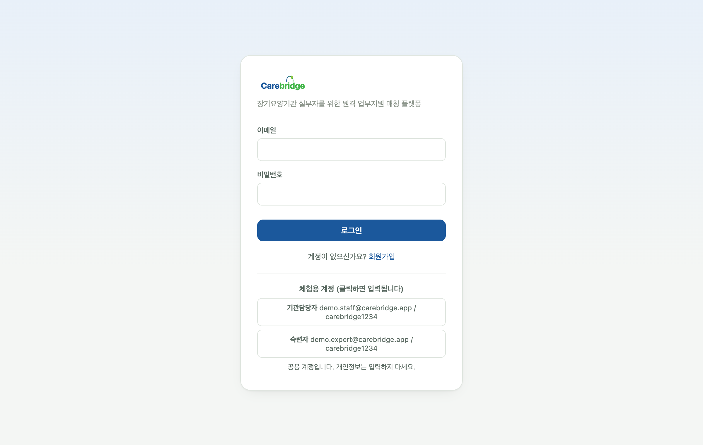
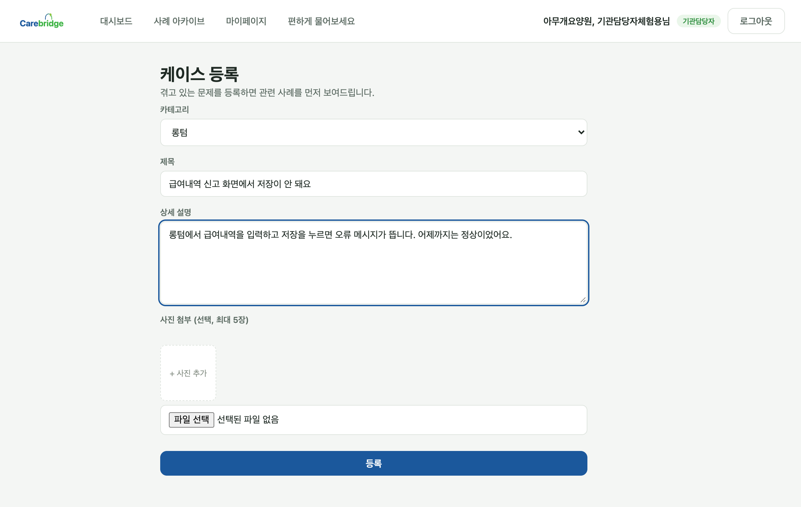
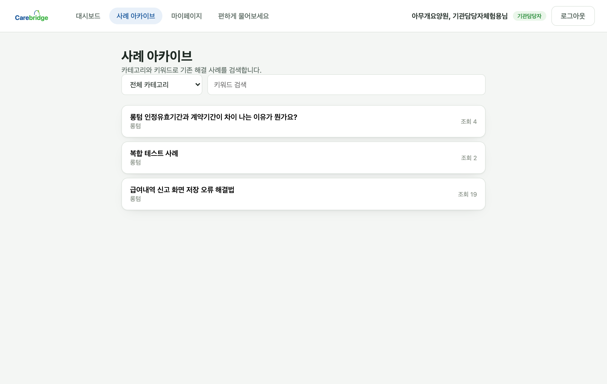
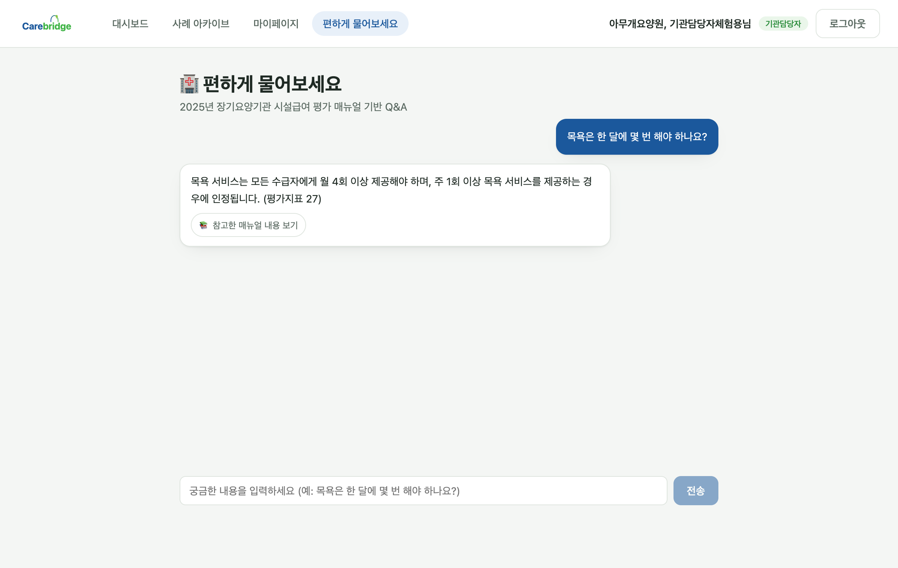
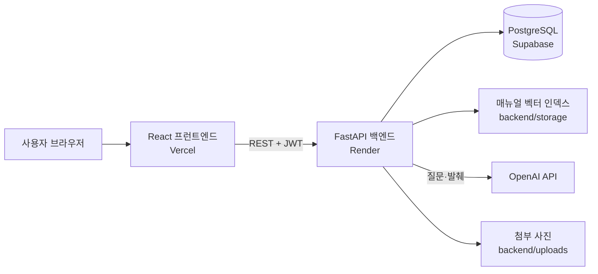

# CareBridge (케어브릿지)

**장기요양기관 실무자의 행정 막힘을, 경험자의 원격 지원과 쌓이는 해결 사례로 풀어주는 플랫폼**
*A platform that connects long-term care facility staff with experienced peers for remote help, and turns every solved problem into a reusable case.*

- 데모 / Live demo: https://carebridge-one-sage.vercel.app
  - 백엔드가 무료 플랜이라 한동안 접속이 없으면 첫 요청에 1분 이상 걸릴 수 있습니다. (Free-tier backend; the first request after idle can be slow.)
- 설계 문서 / Design docs: [요구사항정의서·화면설계서](PG7반_P222_신소영_케어브릿지_개요_텍스트.md) · [API 명세(OpenAPI)](PG7반_P222_신소영_케어브릿지_API.yml) · [DB 설계(DBML)](PG7반_P222_신소영_케어브릿지_DB.dbml)

---

## 1. Problem — 해결하려는 문제

장기요양기관(요양원·재가센터)의 행정 실무자는 장기요양보험 청구, 급여내역 신고 같은 일을 전용 시스템(롱텀 등)으로 처리합니다. 이 일은 담당자가 자주 바뀌고, 처음 맡은 사람은 막히는 일이 잦습니다.

지금은 막히면 공단 콜센터에 전화하는 길이 사실상 유일합니다. 전화 설명만으로 풀리지 않으면 상담원이 원격지원 프로그램(헬프컴 등)으로 담당자 PC에 접속해 해결합니다. 이 과정에는 세 가지 문제가 있습니다.

1. **기다림.** 상담이 지연되는 동안 기관의 청구·행정 업무도 멈춥니다.
2. **반복.** 같은 유형의 문제를 매번 처음부터 문의합니다. 해결 경험이 어디에도 쌓이지 않습니다.
3. **연결 창구 부재.** 문제를 겪는 담당자와, 이미 풀어본 경험자를 이어주는 곳이 콜센터 외에 없습니다.

위 내용은 제가 요양원에서 일하며 저와 동료들이 직접 겪은 경험을 바탕으로 정리한 문제 정의입니다. 자세한 내용은 [요구사항정의서](PG7반_P222_신소영_케어브릿지_개요_텍스트.md)에 있습니다. 정량 통계나 대규모 현장 조사 결과는 아직 없습니다. 현재 근거는 현장 경험이며, 사용자 검증은 로드맵에 있습니다.

## 2. Solution — CareBridge의 해결 방식

| 사용자 | 하는 일 |
|---|---|
| 기관담당자 (staff) | 막힌 문제를 케이스로 등록하고, 해결 사례를 검색하고, 경험자에게 도움을 요청합니다. |
| 숙련자 (expert) | 자신의 전문분야에 맞는 요청을 수락해 원격 상담을 하고, 해결 내용을 사례로 남깁니다. |
| 관리자 (admin) | 등록된 사례를 검수해 공개 여부를 정합니다. |

**흐름**

```
케이스 등록 → 비슷한 해결 사례 먼저 확인 → (안 풀리면) 숙련자 선택·매칭 요청
→ 수락 시 상담 세션 생성 → 원격지원 도구 접속코드로 상담 → 평가
→ 숙련자가 해결 내용을 사례로 등록 → 관리자 승인 → 아카이브에 공개
```

CareBridge는 화면공유·원격제어를 직접 만들지 않습니다. 기존에 쓰던 원격지원 도구(이지헬프, 헬프컴, 구글원격 등)의 접속코드를 세션 안에서 주고받게 합니다.

**기대 효과 (아직 검증되지 않음).** 콜센터 대기 감소, 같은 문제의 자가 해결 증가, 개인 노하우의 자산화. 이 효과는 실제 사용자 데이터로 확인한 것이 아니라 설계 가설입니다.

## 3. Product Demo — 실제 결과물

- **배포 서비스:** https://carebridge-one-sage.vercel.app (로그인 화면에 체험용 계정이 표시됩니다. 공용 계정이라 개인정보는 입력하지 마세요.)
  - 기관담당자: `demo.staff@carebridge.app` / `carebridge1234`
  - 숙련자: `demo.expert@carebridge.app` / `carebridge1234`
- 화면별 설계와 호출 API는 [화면설계서](PG7반_P222_신소영_케어브릿지_개요_텍스트.md)의 SCR-AUTH · MAIN · CASE · MATCH · SESSION · ARCHIVE · MY · ADMIN · MANUAL 항목에 있습니다.

### 화면 / Screens

| 로그인과 체험 계정 | 케이스 등록 |
|---|---|
|  |  |

| 사례 아카이브 | 매뉴얼 Q&A 챗봇 (답변 + 근거) |
|---|---|
|  |  |

위 화면은 배포된 서비스에서 체험 계정으로 직접 캡처했습니다.

## 4. Key Features — 핵심 기능

모든 기능은 소스 코드에서 확인된 것만 적었습니다.

1. **케이스 등록과 관련 사례 자동 노출.** 막힌 문제를 카테고리(롱텀·케어포·희망이음·평가규정·인사/노무·기타)와 함께 등록하고, 오류 화면 사진을 최대 5장 첨부합니다. 같은 카테고리의 승인된 해결 사례가 상세 화면에 먼저 보입니다.
2. **전문분야 기반 숙련자 매칭.** 숙련자는 전문분야를 등록하고, 해당 분야의 케이스만 후보로 노출됩니다. 후보 카드에는 별명과 리뷰 평점을 36.5도 기준 온도로 환산한 '매너온도'가 표시됩니다. 수락 시 상담 세션이 자동 생성됩니다.
3. **원격 상담 세션과 평가.** 원격지원 도구를 고르고 접속코드를 주고받으며 메모를 남깁니다. 접속코드는 담당자 외에는 보이지 않습니다. 세션이 끝나면 1~5점 평가를 남깁니다.
4. **사례 아카이브.** 숙련자가 해결 내용을 사례로 등록하면 관리자가 검수해 공개합니다. 카테고리와 키워드로 검색합니다. 지식이 쌓이는 부분입니다.
5. **매뉴얼 Q&A 챗봇 (RAG).** '2025년 장기요양기관 시설급여 평가 매뉴얼'을 색인해 질문에 답하고, 근거가 된 원문 발췌를 함께 보여줍니다. 근거가 없으면 "매뉴얼에 나와있지 않은 내용입니다."라고 답합니다.

## 5. Why Me — 왜 내가 이 문제를 푸는가

저는 화상 전문 대학병원에서 신규 간호사로 1년 1개월(2023.08~2024.10) 근무했고(격리병실, 소아과, 성형외과 병동), 요양원에서 1년 4개월(2025.02~2026.05) 동안 치매 어르신을 살피는 돌봄 업무를 했습니다. 돌봄 현장은 사람이 사람을 돌보는 일이지만, 그 뒤에서 기관을 굴러가게 하는 행정과 시스템 사용이 현장 인력에게 큰 부담이라는 것을 저와 동료들이 함께 겪었습니다.

그리고 컴퓨터공학을 전공했습니다. 현장에서 본 막힘을 직접 설계하고 구현할 수 있다는 점이 이 프로젝트의 출발점입니다. 요구사항 정의, API·DB 설계, 프런트엔드·백엔드 구현, 배포까지 혼자 진행했습니다.

## 6. AI Opportunity — AI를 통한 발전 가능성

**현재 AI 구현은 OpenAI 기반입니다. Claude API는 아직 연동되어 있지 않습니다.**

| 상태 | 내용 |
|---|---|
| **Implemented** | 매뉴얼 RAG 챗봇. LlamaIndex로 매뉴얼을 색인하고 `gpt-4o-mini`(생성) + `text-embedding-3-small`(임베딩)으로 답변합니다. 검색 후보 6개 사용, 일상 용어('어르신'→'수급자') 보정, 답변 생성 뒤 근거 일치 여부를 다시 판정하는 검증 단계, 사용자별 대화 맥락 분리가 포함됩니다. |
| **In Progress** | 챗봇의 과잉 거절·오답을 줄이는 반복 개선(최근 커밋 이력 기준). 별도의 정량 평가 세트는 아직 없습니다. |
| **Planned** | 아래 세 가지. 모두 구현 전이며 검토 단계입니다. |

**Planned — Claude API로 검토할 기능**

1. **케이스 초안 정리와 사례 추천.** 입력: 담당자가 쓴 문제 설명, 오류 화면 사진. 처리: Claude가 핵심 증상을 정리하고 카테고리를 제안한 뒤, 승인된 아카이브 사례 중 유사한 것을 근거와 함께 보여줍니다. 결과: 담당자는 더 정확한 케이스를 빠르게 등록하고, 유사 사례로 바로 풀 수도 있습니다.
2. **상담 메모의 사례 초안 변환.** 입력: 상담 메모와 케이스 내용. 처리: 개인정보를 가린 뒤 '증상 → 원인 → 해결 단계' 형식으로 초안을 만듭니다. 결과: 숙련자의 사례 작성 부담이 줄어듭니다. 숙련자가 수정·확정하고 관리자가 승인해야 공개됩니다.
3. **매뉴얼·사례 근거 답변 확장.** 챗봇을 평가 매뉴얼뿐 아니라 승인된 사례까지 근거로 삼도록 넓히고, 답변마다 출처를 붙입니다.

**안전장치 (설계 원칙)**

- AI는 제안만 하고, 확정은 사람(담당자·숙련자·관리자)이 합니다. 전문가의 판단을 대체하지 않습니다.
- 모든 답변에 근거 출처를 표시하고, 근거가 없으면 답하지 않습니다. (현재 챗봇에 이미 적용)
- 수급자 이름 등 개인정보·민감정보는 AI에 보내기 전에 가립니다. 케이스 사진에도 같은 원칙을 적용합니다. (현재 미구현)

## 7. Global Potential — 글로벌 확장 가능성

아래는 검증이 필요한 가설이며, 해외 수요나 시장 규모를 확인한 것이 아닙니다.

- **공통 문제 가설.** 돌봄 기관의 행정은 나라마다 정부·보험사 포털을 거칩니다. 담당자 교체가 잦고 도움받을 곳이 한정된 상황은 다른 나라에도 있을 수 있습니다. 핵심은 '막힌 사람 ↔ 풀어본 사람 연결 + 해결 지식의 축적'이며, 이 구조는 특정 시스템에 묶여 있지 않습니다.
- **현지화에서 달라질 것.** 번역만으로는 부족합니다. 국가별 제도와 시스템 이름(카테고리), 지식 근거 문서(매뉴얼에 해당하는 현지 지침), 원격지원 도구, 개인정보 보호 요건(예: 건강·돌봄 정보 처리 규정)을 나라별로 따로 정해야 합니다.
- **다국어.** 현재 UI와 데이터는 한국어 기준입니다. 다국어는 아직 구현되지 않았습니다. AI가 있으면 현지어 사례 검색과 번역이 쉬워지지만, 번역된 사례의 정확성은 사람이 확인해야 합니다.
- **검증 방법.** 한국에서 실사용자 피드백을 얻은 뒤, 다른 제도 환경의 돌봄 실무자 인터뷰로 같은 문제가 있는지 확인하는 것이 순서입니다.

## 8. Tech Stack & Architecture

| 구분 | 기술 | 역할 |
|---|---|---|
| 프런트엔드 | React 19, TypeScript, Vite, React Router | 웹 UI (Vercel 배포) |
| 백엔드 | Python 3.11, FastAPI, SQLAlchemy | REST API, 역할 기반 접근제어 (Docker, Render 배포) |
| 인증 | JWT(python-jose), bcrypt(passlib) | 로그인, 비밀번호 해시 저장 |
| DB | PostgreSQL (배포: Supabase) | 사용자·케이스·매칭·세션·사례 |
| AI | LlamaIndex, OpenAI(`gpt-4o-mini`, `text-embedding-3-small`) | 매뉴얼 RAG 챗봇 |
| 운영 | APScheduler + pg_dump | 일 1회 백업 (관리형 DB 사용 시 `BACKUP_ENABLED=false`) |
| 데모 | Streamlit ([app.py](app.py)) | 챗봇 단독 데모 UI |



## 9. Getting Started

**사전 요구사항:** Python 3.11, Node.js, PostgreSQL, OpenAI API 키, (백업 사용 시) `pg_dump`

```bash
# 1) 환경변수: 루트의 .env.example을 복사해 값을 채웁니다.
cp .env.example .env
#   OPENAI_API_KEY, DATABASE_URL, JWT_SECRET_KEY, CORS_ORIGINS, BACKUP_ENABLED

# 2) 백엔드 (http://localhost:8000, 상태 확인: /health)
cd backend
pip install -r requirements.txt
uvicorn app.main:app --reload

# 3) 프런트엔드 (http://localhost:5173)
cd ../frontend
cp .env.example .env     # VITE_API_BASE_URL=http://localhost:8000
npm install
npm run dev
```

- 최초 실행 시 테이블과 기본 카테고리가 자동 생성됩니다.
- 챗봇만 보려면 루트에서 `pip install -r requirements.txt` 후 `streamlit run app.py`를 실행합니다.
- 프런트엔드 정적 검사: `npm run lint`, 빌드: `npm run build`
- **테스트:** 자동화 테스트 코드는 아직 없습니다.
- 배포 설정은 [render.yaml](render.yaml)(백엔드)과 [frontend/vercel.json](frontend/vercel.json)(프런트엔드)에 있습니다.

## 10. Roadmap

우선순위 순입니다.

1. 실제 기관 실무자·숙련자 대상 사용성 검증과 피드백 수집
2. 핵심 흐름(가입→매칭→세션→사례)과 챗봇 답변 품질에 대한 자동화 테스트·평가 세트
3. Claude API 기반 케이스 정리·유사 사례 추천, 사례 초안 생성 (개인정보 마스킹과 사람 확인 포함)
4. 관리자 화면의 회원 상태·카테고리 관리 UI (API는 구현됨)
5. 첨부 사진 영구 저장소 (무료 배포 환경에서는 재배포 시 사라짐)
6. 사례 아카이브 대량 데이터 기준 성능 검증 (2초 목표, 부하 테스트 미실시)
7. 다국어와 국가별 제도 확장 가능성 조사

## 11. Closing

CareBridge는 현장에서 막힌 사람과 이미 풀어본 사람을 잇고, 그 해결 경험을 모두가 쓸 수 있는 지식으로 바꾸려는 시도입니다. 지금은 한국 장기요양 행정에서 동작하는 첫 버전이며, 실사용자 검증과 AI 기반 지원, 다른 돌봄 환경에서의 적용 가능성은 앞으로 하나씩 확인해 갈 과제입니다.
